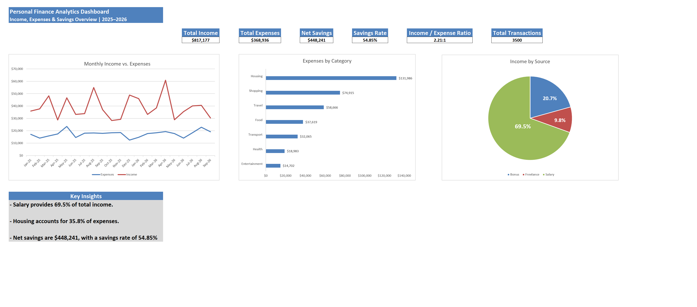

# Personal Finance Analytics Dashboard

## Overview

An end-to-end financial analytics project built using Microsoft Excel and Power Query. The project uses a synthetic dataset of 3,500 transactions covering January 2025 through September 2026.

The goal is to analyze income, expenses, savings performance, monthly trends, spending categories, and income sources, then communicate the results through an Excel dashboard.

> **Disclaimer:** All transaction data is synthetic and created for portfolio and learning purposes. It does not represent real personal financial records.

## Business Objectives

This project explores the following questions:

- How much income and expenses were recorded?
- What are the resulting net savings and savings rate?
- How does financial performance change month to month?
- Which expense categories account for the largest share of spending?
- Which income sources contribute the most?
- What insights can be drawn from the overall financial patterns?

## Tools & Skills

- Microsoft Excel
- Power Query
- Data cleaning and transformation
- Excel formulas and structured references
- PivotTables and PivotCharts
- KPI development
- Monthly and category analysis
- Dashboard design and data visualization
- Business insights and recommendations

## Data Preparation

The dataset contains 3,500 synthetic transactions and 10 fields.

Key preparation steps included:

- Reviewed column quality and data types
- Trimmed inconsistent whitespace in text fields
- Investigated missing payment method values
- Created a cleaned dataset using Power Query
- Added a cleaned category field to standardize category labels
- Preserved valid transactions while addressing data-quality issues

## Key Performance Indicators

| KPI | Result |
|---|---:|
| Total Income | $817,177 |
| Total Expenses | $368,936 |
| Net Savings | $448,241 |
| Savings Rate | 54.85% |
| Total Transactions | 3,500 |
| Average Expense | $132 |
| Highest Expense Transaction | $1,108 |
| Expense Categories | 7 |
| Income-to-Expense Ratio | 2.21:1 |

## Key Findings

### Monthly Performance

Income fluctuates considerably across the period, while expenses are comparatively stable. Some months record notably stronger savings than others.

### Expense Analysis

Housing is the largest expense category, accounting for approximately 35.8% of total expenses. Shopping is the second-largest category at approximately 20.3%, while Entertainment is the smallest category.

### Income Analysis

Salary is the largest income source, contributing approximately 69.5% of total income. Freelance income is the smallest of the three income sources analyzed.

### Overall Savings

The dataset records approximately $448,241 in net savings, equivalent to a savings rate of 54.85%.

These findings describe the synthetic dataset and should not be interpreted as conclusions about real personal finances.

## Dashboard

The Excel dashboard presents six KPIs:

- Total income
- Total expenses
- Net savings
- Savings rate
- Income-to-expense ratio
- Total transactions

It also includes three visualizations:

- Monthly income versus expenses
- Expenses by category
- Income by source

## Workbook Structure

- `Raw_Data` — original synthetic transaction dataset
- `Clean Table` — cleaned dataset produced through Power Query
- `Analysis` — overall KPI calculations
- `Monthly Analysis` — monthly income, expenses, net savings, and savings rate
- `Expense & Income Analysis` — category spending and income-source analysis
- `Dashboard` — KPI cards, charts, and key insights

## Portfolio Summary

This project demonstrates an end-to-end Excel analytics workflow, from data preparation and KPI calculation through exploratory analysis, visualization, and insight communication. It focuses on transforming transaction-level data into a clear financial performance overview.

The workbook is provided for demonstration and learning purposes.
